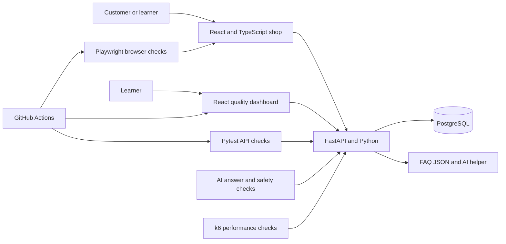

# ShopGuard AI

ShopGuard AI is a practice e-commerce platform and quality engineering lab. It combines a FastAPI and PostgreSQL shop, a React storefront and quality dashboard, and automated browser, API, AI safety, AI evaluation, and performance checks. Payments are simulated; the project does not process real payment data.

> **GitHub repository description:** Practice e-commerce shop and quality engineering lab with FastAPI, React, PostgreSQL, Playwright, API and AI checks, k6 performance tests, Docker, and CI.

## What this project is for

ShopGuard Market is a pretend online shop used to learn how to build and test software. A customer can browse products, create an account, add items to a basket, and place a simulated order. A separate quality dashboard gathers test results so a learner can see whether the shop is working well.

It is useful for practicing both sides of quality engineering: writing an application and checking it with browser, API, AI safety, AI answer quality, and performance tests. It is a learning project; payments are simulated and no real card details are collected.

## Languages and tools

| Language or tool | What it does here |
| --- | --- |
| Python | FastAPI backend, shop logic, AI helpers, API tests, and reporting tools |
| TypeScript | React pages and Playwright browser automation |
| JavaScript | k6 performance scenario and web build configuration |
| SQL | PostgreSQL tables and database queries through SQLAlchemy and Alembic |
| CSS and HTML | Storefront and dashboard styling and page structure |
| PostgreSQL | Saves accounts, products, baskets, orders, and AI test case drafts |
| Docker Compose | Starts the web app, API, and database together |
| GitHub Actions | Runs automated checks when code is pushed or a pull request is opened |

The AI support helper uses the local mock provider by default; an OpenAI provider can be enabled with a private API key. The FAQ knowledge is currently stored in a JSON file. ChromaDB is not part of the implemented application.

## How the parts connect



## What the interface looks like

The **ShopGuard Market** page has a warm, simple shop design: a welcome section, product cards, category and sort filters, search, sign-in, and a basket. Choose **Quality dashboard** in the top menu to see pass/fail status, latest saved checks, and recent run history. The dashboard reads summaries from the API; run the test commands to refresh those results. Start the local pages with `make api` and `make web` as described below.

This project is being built in phases so each part can be learned and reviewed before moving on. The system plan is in [the Phase 1 architecture](docs/architecture/phase-1-requirements-and-architecture.md), and a beginner-friendly overview is in [the project guide PDF](outputs/shopguard-ai-project-guide.pdf).

## Current tech stack

- Python 3.12+ (local interpreter: 3.15.2) and FastAPI for the backend
- React and TypeScript for the storefront and quality dashboard
- PostgreSQL for shop and test records
- Playwright with TypeScript for browser automation
- Pytest and Requests for API automation
- k6 for performance checks
- Docker Compose and GitHub Actions for local services and automation

The earlier design considered ChromaDB for chatbot search; it is not currently installed or used. The implemented helper searches the project FAQ JSON data.

## Where to find the code

```text
apps/
  api/                 FastAPI routes, shop rules, database models, migrations
  web/                 React storefront, quality dashboard, Playwright checks
automation/
  api/                 Python API clients and endpoint tests
  ai/                  AI answer evaluation and safety checks
  performance/         k6 load script
  reporting/           Test result summaries and combined report
docs/
  architecture/        System design
  development/         Beginner-friendly phase guides
  reports/             Latest combined quality report
data/knowledge_base/   FAQ content used by the support helper
```

The Phase 3 backend supports customer accounts, product search, stock, shopping baskets, simulated checkout, order history, and cancellation. Phase 4 adds a small React storefront and reusable Playwright browser tests for customer journeys.

## Phase 2: prepare your computer

Python 3.15.2 is installed for this project, and Node.js 24 is already present. The `.python-version` and `.nvmrc` files record the versions to use. Version checks:

```bash
python3.15 --version
node --version
npm --version
```

Expected: Python reports `3.15.2`, Node reports `v24...`, and npm prints a version number.

Create a Python virtual environment and install the development tools:

```bash
make setup-python
```

The virtual environment is a separate toolbox for this project. It keeps project tools away from the rest of your computer.

Run the repository checks:

```bash
make lint
make format-check
make test
```

The checks include repository setup tests and API tests. API tests use the separate `shopguard_test` database.

## Phase 3: run the shop backend

PostgreSQL must be running. Create the two local databases once, if they do not already exist:

```bash
createdb shopguard
createdb shopguard_test
```

Create your private settings file and install the backend packages:

```bash
cp .env.example .env
make setup-python
```

Create the database tables and add sample products:

```bash
make db-migrate
make db-seed
```

Start the API:

```bash
make api
```

Open [http://127.0.0.1:8000/docs](http://127.0.0.1:8000/docs) to try the API in your browser. The backend walkthrough, sample requests, and explanation of each logic file are in [the Phase 3 guide](docs/development/phase-3-backend.md).

In IntelliJ, open the **Terminal** panel and run the tests with:

```bash
make test
```

The API test fixture clears and recreates tables only inside `shopguard_test`. Do not point the test suite at the `shopguard` database.

## Phase 4: storefront and browser automation

Install the JavaScript packages and Playwright's browser engines once:

```bash
make web-install
make ui-browsers
```

Run the browser suite from IntelliJ's Terminal:

```bash
make ui-test-chromium
```

To run all three configured browsers, use `make ui-test`. To open the latest report, use `make ui-report`. The storefront itself starts with `make web` and opens at `http://127.0.0.1:5173`. The [Phase 4 guide](docs/development/phase-4-playwright.md) explains the framework and each test in simple steps.

## Phase 5: Python API automation

Keep the API server running in one IntelliJ Terminal tab (`make api`). In another tab run:

```bash
make api-test
```

This suite uses Requests to exercise the public HTTP endpoints, including authentication, product queries, basket changes, checkout, stock errors, and role restrictions. It validates response JSON against the live OpenAPI contract and prints method, route, status, and elapsed time. Point it at another environment with `SHOPGUARD_API_URL=http://host:port make api-test`. The [Phase 5 guide](docs/development/phase-5-api-automation.md) explains the client and tests.

## Phase 6: AI support and test-case drafts

After signing in to the storefront at `http://127.0.0.1:5173`, scroll to **Support & quality lab**. The support helper answers from the shop FAQ and shows which note it used. The test-case helper turns a written requirement into draft test ideas. These drafts are saved for review; they do not run automatically. The API has matching endpoints under `/ai` in the API docs.

Phase 6 works locally with `AI_PROVIDER=mock`, which is a predictable practice mode and makes no external AI calls. To enable live OpenAI answers, put your own key in the private `.env` file, then set `AI_PROVIDER=openai`; the key stays on the backend. Restart the API after changing `.env`. Do not paste a real API key into source code or the browser. See the [Phase 6 guide](docs/development/phase-6-ai-helpers.md) for setup, API routes, and how to review suggestions.

## Phase 7: measure AI answer quality

Run `make ai-eval` in IntelliJ's Terminal. It checks a small set of known questions, whether the right FAQ notes were found, whether expected answer details appeared, and response time. The standard run uses the mock provider and makes no external AI calls. The report is saved to `outputs/test-results/ai-evaluation-latest.json`. Read [the Phase 7 guide](docs/development/phase-7-ai-evaluation.md) to understand the scores and add more examples.

## Phase 8: AI safety checks

Run `make ai-security-test` to check tricky prompts such as "ignore your rules," attempts to get private customer information, and model output that tries to approve or run a test by itself. These checks use a mock model and fake provider calls; they need no server or API key. See [the Phase 8 guide](docs/development/phase-8-ai-security.md).

## Phase 9: performance checks

Install k6 once with `brew install k6`, then start the API with `make api`. Run `make perf-smoke` for a quick one-user check or `make perf-test` for the default small load. The read-only k6 script checks health, product listing, and product search. It saves results to `outputs/test-results/performance-latest.json`. See [the Phase 9 guide](docs/development/phase-9-performance.md) for setup and score explanations.

## Phase 10: quality dashboard

Start the API and web app, then choose **Quality dashboard** in the shop's top menu. It shows saved browser, API, AI, and performance check results, plus recent runs. Test commands save short summaries in `outputs/test-results`; the dashboard reads them through `GET /quality/summary`. See [the Phase 10 guide](docs/development/phase-10-quality-dashboard.md).

## Phase 11: Docker and CI/CD

To start the shop, API, and PostgreSQL database together in Docker, run `make docker-up`. Open `http://127.0.0.1:5173`; the shop sends API requests through the web container. Run `make docker-logs` to read service messages and `make docker-down` to stop the services. The database stays saved when the services stop. GitHub Actions runs Python and browser checks, builds the web app and Docker images, and saves a report on each push and pull request. See [the Phase 11 guide](docs/development/phase-11-docker-ci.md).

## Phase 12: integrated results and reports

Phase 12 connects saved browser, API, API component, AI safety, AI answer, and performance results to the quality dashboard. Run the relevant test commands, then use `make quality-report` to create `docs/reports/quality-report-latest.md`. GitHub Actions saves the JUnit files, summaries, browser artifacts, and combined report as a downloadable workflow artifact. See [the Phase 12 guide](docs/development/phase-12-integration-reporting.md) and the [simple Phase 12 PDF](output/pdf/shopguard-phase-12-integration-reporting-guide.pdf).

## Local settings

Copy `.env.example` to `.env` when local services are added. `.env` is ignored by Git so private values are not committed. Keep real API keys out of source files and chat logs.

## Project phases

1. Requirements and architecture
2. Repository and environment setup
3. E-commerce backend and PostgreSQL
4. Playwright automation framework
5. Python API automation framework
6. AI chatbot and test-case generator
7. LLM and RAG evaluation
8. AI security testing
9. Performance testing
10. React dashboard
11. Docker and CI/CD
12. Integration, reporting, and documentation
