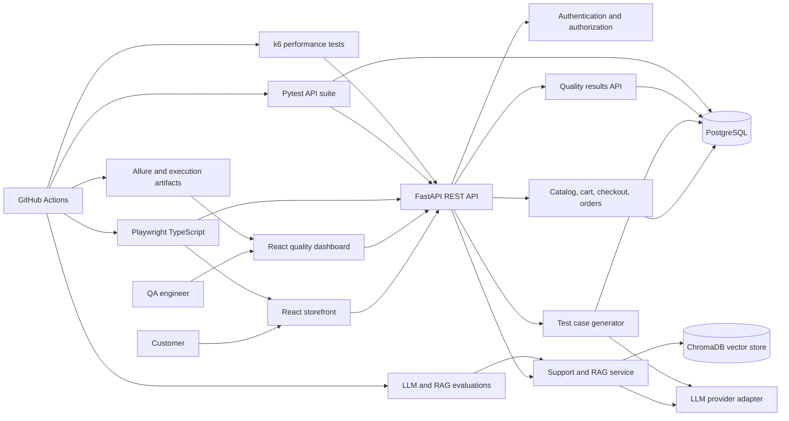

# ShopGuard AI — Phase 1: Requirements and Architecture

## Purpose

ShopGuard AI is a portfolio application that combines a realistic, simulated e-commerce service with a quality engineering platform. It is designed to demonstrate backend development, UI and API automation, AI and RAG evaluation, security testing, performance testing, and CI/CD. This phase records the proposed system before implementation.

## Scope and boundaries

The product has two user-facing experiences: a customer storefront and a quality engineering dashboard. A FastAPI service provides the API and business rules for both. PostgreSQL is the system of record for commerce and test history. ChromaDB supports knowledge retrieval for the support assistant. Automation suites exercise the application and publish results for reporting.

Payments are simulated. The application must not collect or store real payment credentials. AI-generated test cases are drafts until a QA engineer reviews and approves them; unreviewed cases are never executed automatically. Normal CI uses mocked LLM responses. Real-model runs are separate, explicitly configured workflows that use secrets.

## Architecture



The backend is the integration point and owns REST contracts, validation, authentication, authorization, and business rules. The React storefront and dashboard call it through documented APIs. Automation targets the same interfaces and browser journeys as users. The dashboard reads recorded results through the backend rather than depending on CI internals.

## System components

| Component | Responsibility |
|---|---|
| React storefront | Registration and login, product discovery, cart, simulated checkout, order history, and support chat. |
| FastAPI backend | REST routes, Pydantic validation, access control, commerce rules, OpenAPI schema, support and quality endpoints. |
| PostgreSQL | Users, products, inventory, orders, test cases, executions, results, evaluation runs, prompts, and document metadata. |
| ChromaDB | Embeddings and similarity search over approved support knowledge. |
| LLM provider adapter | Provider-neutral model calls, structured output handling, configuration, and deterministic mock implementation. |
| Playwright suite | TypeScript browser automation with page objects, fixtures, cross-browser configuration, traces, screenshots, and video on failure. |
| Pytest API suite | Reusable Requests client, contract checks, auth and negative cases, and selected database assertions. |
| AI evaluation and security suites | Golden dataset checks for correctness and retrieval, plus prompt injection, unsafe output, and disclosure tests. |
| k6 suite | Configurable load profiles for catalog, search, login, cart, checkout, orders, and a separately measured AI endpoint. |
| Quality dashboard | Historical suite results, AI/RAG/security/performance metrics, filters, and failure trends. |
| GitHub Actions | Fast pull-request quality gates and longer scheduled or manually triggered regression runs. |
| Docker Compose | Local services for API, frontend, PostgreSQL, Redis, and supporting infrastructure. |

Redis is available for later needs such as rate limiting or caching; initial commerce flows should not depend on it without a demonstrated requirement.

## Data flows

### Customer purchase

1. The storefront sends catalog queries to the API; the API reads product and inventory records from PostgreSQL.
2. Cart and checkout requests are checked against inventory, quantities, and discount rules.
3. The API creates an order and order items in a database transaction, simulates payment, and returns confirmation.
4. The customer can read order history or request cancellation; the API enforces valid state transitions.

### Support assistant

1. The support endpoint receives a user question.
2. The RAG service embeds the question and retrieves relevant knowledge chunks from ChromaDB.
3. The service builds bounded context from the approved policies, FAQs, or product documentation.
4. The provider adapter generates an answer (or a deterministic mock does so in ordinary CI).
5. Evaluation runs compare answers and retrieval against golden examples; response and evaluation metadata can be recorded.

### AI test-case generation

1. A QA engineer submits a requirement through the dashboard.
2. The generator requests structured test cases from the selected provider.
3. Pydantic validates fields; the service assigns unique IDs and flags likely duplicate scenarios.
4. The output is stored in draft status for human review.
5. Only approved cases can be exported or considered for execution.

### Quality execution and reporting

1. GitHub Actions selects suites according to pull request, push, schedule, or manual dispatch.
2. Playwright, API, AI evaluation/security, and selected k6 suites run against a configured environment.
3. Suites emit machine-readable results and retain relevant artifacts such as traces, screenshots, evaluation metrics, and Allure data.
4. Execution summaries and results are persisted in PostgreSQL.
5. The dashboard shows current and historical outcomes by suite, date, and environment.

## Proposed repository structure

```text
shopguard-ai/
├── apps/
│   ├── api/                         # FastAPI service
│   │   ├── app/
│   │   │   ├── api/                 # REST routes and dependencies
│   │   │   ├── core/                # Settings, logging, security
│   │   │   ├── domain/              # Business rules and entities
│   │   │   ├── repositories/        # Persistence access
│   │   │   ├── services/            # Commerce, support, generation
│   │   │   └── main.py
│   │   ├── migrations/              # PostgreSQL migrations
│   │   └── tests/                   # Backend unit and integration tests
│   └── web/                         # React + TypeScript applications
│       ├── src/
│       │   ├── app/
│       │   ├── components/
│       │   ├── features/
│       │   └── services/            # API client
│       └── tests/
├── automation/
│   ├── api/                         # Pytest + Requests
│   │   ├── clients/
│   │   ├── schemas/
│   │   └── tests/
│   ├── ui/                          # Playwright + TypeScript
│   │   ├── pages/
│   │   ├── fixtures/
│   │   └── tests/
│   ├── ai/                          # LLM/RAG evaluation and security
│   │   ├── golden_data/
│   │   └── tests/
│   └── performance/                 # k6 scripts and profiles
├── data/knowledge_base/             # Versioned sample policies and FAQs
├── docs/
│   ├── architecture/
│   ├── decisions/                   # Architecture Decision Records
│   └── reports/                     # Labeled sample artifacts
├── .github/workflows/
├── docker-compose.yml
├── .env.example
└── README.md
```

## Technology choices

- **Python, FastAPI, and Pydantic:** a typed, testable API with request validation and generated OpenAPI contracts.
- **React and TypeScript:** one frontend stack for customer and engineering workflows, with compile-time checks for UI code.
- **PostgreSQL:** relational integrity and transactions suit inventory and order behavior, while also supporting queryable test history.
- **ChromaDB:** a local vector store supports a demonstrable RAG workflow without requiring a hosted vector service.
- **Playwright with TypeScript:** browser automation, browser contexts, parallel execution, and rich failure artifacts in a reusable framework.
- **Pytest and Requests:** direct, maintainable API tests with Python fixtures and schema validation.
- **k6:** version-controlled, configurable load scenarios with percentile and throughput measurements.
- **Docker Compose and GitHub Actions:** reproducible local services and automated quality gates, with secrets kept outside source control.
- **Allure plus application reporting:** Allure provides detailed run artifacts; the application dashboard presents stored history and trends.

Provider abstraction and deterministic mocks make AI behavior testable and keep standard CI costs predictable. LLM-as-a-judge metrics are evidence to inspect, not proof of factual correctness; deterministic assertions and curated references are preferred where possible.

## Development milestones

1. Requirements and architecture (this phase).
2. Repository and environment setup, conventions, configuration, and linting.
3. Commerce backend, PostgreSQL schema, migrations, and core API flows.
4. Playwright framework and customer journey coverage.
5. Python API framework, contracts, authorization, negative/boundary cases, and database checks.
6. Support chatbot, knowledge ingestion, and draft-only test-case generation.
7. Golden datasets and LLM/RAG evaluation runs.
8. AI security regression checks.
9. Configurable performance scenarios and measured baselines.
10. Quality dashboard and historical reporting.
11. Docker, CI/CD workflows, quality gates, and artifact retention.
12. Integration, portfolio documentation, and demonstrable reports.

Each phase should have working acceptance criteria and a review before starting the next. Implementation details and commands belong in the relevant phase documentation as they are built.

## Skills demonstrated

| Module | Skills gained |
|---|---|
| Commerce service | REST design, Python typing, validation, transactions, relational modeling, authentication, and practical security. |
| Browser automation | TypeScript, page objects, fixtures, resilient locators, browser contexts, and failure diagnosis. |
| API automation | Pytest, Requests, OpenAPI contracts, authorization, boundary tests, and database assertions. |
| AI generation and evaluation | Structured outputs, provider abstraction, mocking, golden datasets, repeatability, and metric interpretation. |
| RAG and AI security | Retrieval measurement, context grounding, injection testing, unsafe output checks, and data disclosure testing. |
| Performance | Load profile design, percentile latency, throughput, error rates, and separate AI endpoint measurements. |
| CI/CD and reporting | Automated quality gates, secrets management, artifact retention, test reporting, and historical trends. |
| Engineering practice | Migrations, configuration hygiene, modular design, architecture decision records, and maintainable documentation. |

## Initial acceptance criteria

Phase 1 is complete when the architecture, component boundaries, data flows, repository proposal, technology rationale, milestones, and learning outcomes are documented and reviewed. Before implementation, the project owner should approve this architecture or request changes. No application implementation code is part of Phase 1.

## Known design constraints

- This is a portfolio-scale system, so each capability should be added in milestone order rather than built all at once.
- Payment processing is simulated and must not accept real payment credentials.
- Routine CI should use mocked model responses; real provider calls require configured secrets and a separate workflow.
- Performance findings must come from measured runs and must not be presented as invented results.
- AI-generated test cases require human approval before use.
